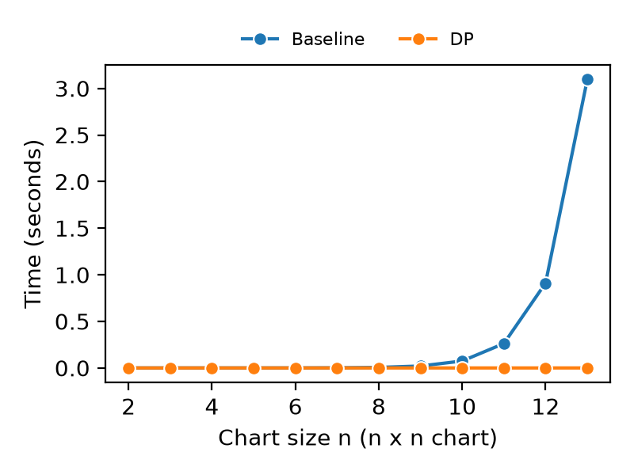
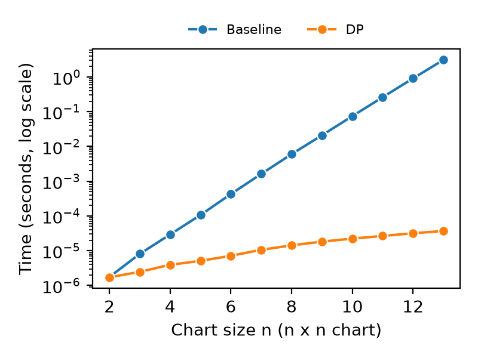
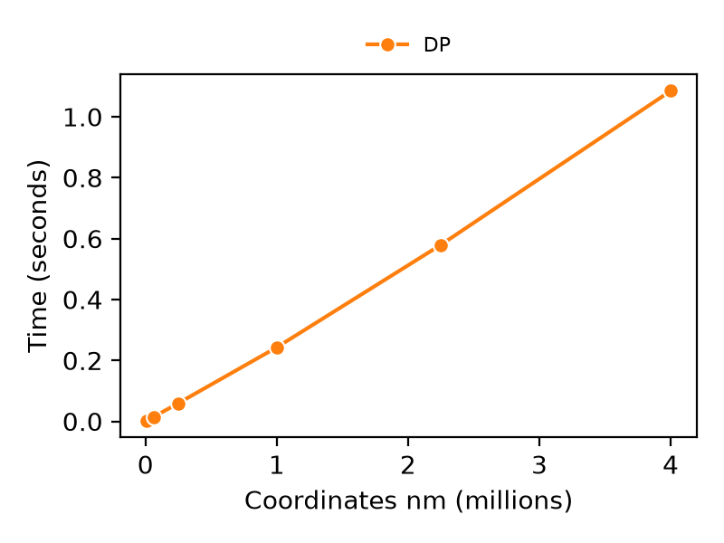
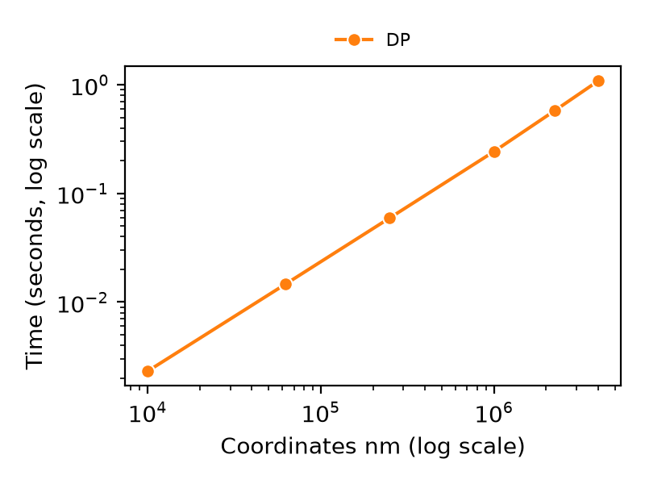

# Empirical Evaluation

## Overview

We implemented both algorithms from `planning.md` in `src/methods.py`. `SubmersiblePathBaseline` is the exhaustive search. It calls the recursive helper `FindBestPath` once for every surface column, and the helper tries every legal move to the next row and keeps the completed path with the highest total. `SubmersiblePathDP` is our proposed algorithm. It fills the tables $D$ and $P$ one row at a time from the surface down, picks the best coordinate on the ocean floor, and follows $P$ back up to rebuild the path. Both functions follow the pseudocode in `planning.md` step by step. The only difference is that rows and columns are numbered from 0 in the code, so the coordinates in a returned path can be used to index the chart directly.

Both functions take the chart as a list of rows and return a pair `(best_score, best_path)`, where `best_path` has one `(row, column)` coordinate for each row. They raise a `ValueError` if the chart is empty or its rows have different lengths. When several paths tie for the best score, both return the one that is furthest left in every row, so on the same chart they always return exactly the same result. Because of this, our tests compare whole results and not just scores.

## Testing

Our tests are in `src/tests.py` and use Python's `unittest` module. They can be run from the `src` folder with `python3 -m unittest tests -v`. All 14 tests pass, and the whole suite takes about half a second. The tests fall into five groups:

- Hand-written cases. There are 15 small charts with known answers, including the example from `planning.md`, a single coordinate, a single row, a single column, charts where every score is negative or every score is equal, a chart where always moving to the highest next score gives the wrong answer, and charts with float scores. Two of them check that a path cannot wrap around from one edge of the chart to the other, which would be an easy bug to make in Python because `chart[i][-1]` is a valid index.
- Comparison against an independent reference. The reference checks every sequence of columns with `itertools.product` and does not share any code with `methods.py`. Both algorithms are compared against it on 500 random charts of up to $6 \times 6$. The scores are drawn from -3 to 3 so that ties happen often, and the test checks that the returned path matches, not only the score. We also compare the two algorithms with each other on 200 random charts with float scores.
- Charts with a known optimal path. We place a path of 100s on a chart whose other scores are between -10 and 10, so that path has to be the only optimal one. Both algorithms are checked this way on five charts such as $9 \times 9$ and $10 \times 4$. The DP is also checked on much larger charts that the baseline could not finish, including $500 \times 500$, $1000 \times 30$, $30 \times 1000$ and a single column of 5,000 rows.
- Input handling. Empty and non-rectangular charts must raise `ValueError`, and neither algorithm may change the chart it is given. The second test matters for the benchmark, which passes the same chart to both algorithms and to every trial.
- The recursive helper. These tests call `FindBestPath` directly on partial paths and check that the baseline makes exactly 27 calls to it on the `planning.md` example, which is the number we gave in `planning.md`.

The benchmark adds one more check. On every chart in Experiment 1 it compares the results of the two algorithms after timing them, and they were identical for all 12 sizes.

## Benchmarking Setup

`src/benchmark.py` measures the running time of both algorithms and writes every measurement to `assets/empirical_results.csv`. It can be run from the `src` folder with `python3 benchmark.py` and takes about half a minute. `src/plots.ipynb` reads this file and produces the plots and the numbers in the tables below.

Every input is a square $n \times n$ chart of random integer scores from -100 to 100, generated with a fixed seed of 42 so the results can be reproduced. We did not need to build a special worst-case input. The scores change which path is returned, but they do not change how many paths the baseline explores or how many entries the DP fills in, so any chart of a given size takes about the same time.

For each size, we generate one chart and run each algorithm on it 5 times. Only the call to the algorithm is timed, using `time.perf_counter`, and we report the median of the 5 trials because it is less affected by a single slow run. For example, at $n = 2$ the first baseline trial took 10.5 µs while the other four took between 1.3 and 3.0 µs. All measurements were taken with Python 3.15.2 on an arm64 Mac running macOS 27.2.

We ran two experiments:

1. Comparison: both algorithms on $n \times n$ charts for $n = 2$ to $13$. At $n = 13$ one baseline run already takes about 3 seconds, and each extra row and column multiplies that by about 3.4, so we stopped there.
2. Scalability: only the DP, on $n \times n$ charts for $n$ = 100, 250, 500, 1,000, 1,500 and 2,000, which is 10,000 to 4,000,000 coordinates. The baseline cannot be run at these sizes. We stopped at 2,000, where one run takes about a second, because the trend was already clear.

## Results

### Experiment 1: Comparison

|  |  |
| --- | --- |

The left plot uses a linear time axis. The baseline stays close to zero up to about $n = 10$ and then rises quickly to 3.10 seconds at $n = 13$, while the DP line cannot be told apart from zero. The right plot shows the same data with a logarithmic time axis. On this scale the baseline points lie almost on a straight line, which is what exponential growth looks like when only the time axis is logarithmic. The DP also gets slower as $n$ grows, from 1.7 µs at $n = 2$ to 37 µs at $n = 13$, but much more slowly, so the gap between the two lines keeps getting wider.

| $n$ | Coordinates | Baseline (ms) | DP (ms) | Baseline / DP |
| ---: | ---: | ---: | ---: | ---: |
| 4 | 16 | 0.0293 | 0.0039 | 7.5 |
| 7 | 49 | 1.62 | 0.0106 | 153 |
| 10 | 100 | 74.6 | 0.0222 | 3,357 |
| 13 | 169 | 3,095 | 0.0368 | 84,128 |

At $n = 2$ the two algorithms take the same time, about 1.7 µs, since a $2 \times 2$ chart has only 4 valid paths and there is almost no repeated work for the DP to save. By $n = 13$ the DP is about 84,000 times faster than the baseline.

### Experiment 2: Scalability

|  |  |
| --- | --- |

In the second experiment we ran only the DP, on charts from $100 \times 100$ up to $2{,}000 \times 2{,}000$, which is 10,000 to 4,000,000 coordinates. The largest chart took 1.08 seconds. In the left plot both axes are linear, and the points fall close to a straight line through the origin, which is what we expect if the running time is proportional to $nm$. The right plot shows the same data on log scales. A running time of the form $c(nm)^k$ shows up there as a line with slope $k$, and fitting the six medians gives a slope of 1.024. Going from the smallest chart to the largest multiplies the number of coordinates by 400 and the time by about 470.

### Comparison with the Complexity Analysis

For the DP, `planning.md` gives a running time of $\Theta(nm)$. A slope of 1.024 on the log-log plot means the time grew almost exactly in proportion to the number of coordinates, so the measurements agree with this bound.

For the baseline, `planning.md` gives the upper bound $O(nm3^{n-1})$. On an $n \times n$ chart this is $n^2 3^{n-1}$, so if the time grew exactly like the bound, going from $n$ to $n + 1$ would multiply it by $3((n+1)/n)^2$. The table compares this with the measured ratio of the medians for the larger sizes. The ratios for every size are computed in `src/plots.ipynb`.

| From $n$ | To $n$ | Measured ratio | $3((n+1)/n)^2$ |
| ---: | ---: | ---: | ---: |
| 8 | 9 | 3.49 | 3.80 |
| 9 | 10 | 3.56 | 3.70 |
| 10 | 11 | 3.51 | 3.63 |
| 11 | 12 | 3.48 | 3.57 |
| 12 | 13 | 3.40 | 3.52 |

The measured ratio was below the bound's ratio for every step from $n = 2$ to $13$, not only the ones shown here. This is expected, because the bound assumes three moves from every coordinate, but a coordinate on the left or right edge of the chart has only two. For $n \ge 8$ the measured ratio stays between 3.4 and 3.6, so each step makes the baseline about 3.5 times slower. If the ratio stayed at 3.4, a single run on a $20 \times 20$ chart would take around 16,000 seconds, or about four and a half hours. We did not run this, so it is only an estimate, but the DP would finish the same chart in well under a millisecond.

## Summary

Both algorithms gave the correct result on every test, including 500 random charts checked against an independent brute-force reference, and they returned identical results on every chart we timed. The baseline's running time grew by a factor of about 3.5 for each step from $n$ to $n + 1$, which fits the exponential bound in `planning.md`, and it reached 3.10 seconds on a $13 \times 13$ chart. The DP's running time grew in proportion to the number of coordinates, with a fitted slope of 1.024, and it handled a $2{,}000 \times 2{,}000$ chart in 1.08 seconds. For anything beyond very small charts, the DP is the only practical choice of the two.
